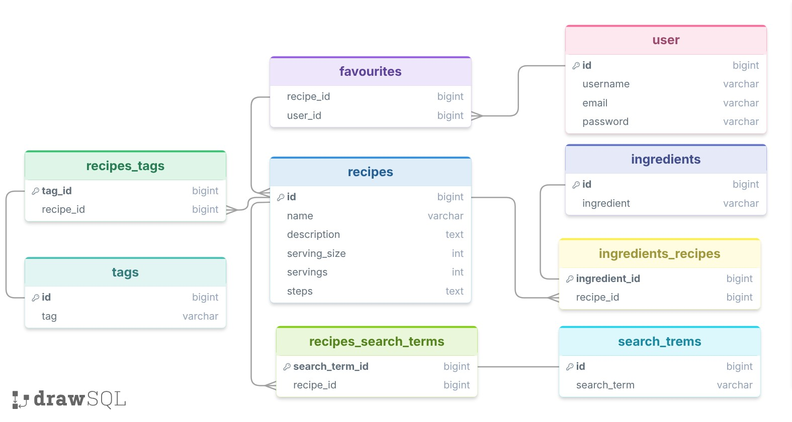

# Food Recipes API

A RESTful recipe discovery API built with **Java 25** and **Spring Boot
4.1.1**. It lets users discover recipes by ingredients and tags, search
for recipes by name, and manage their favourite recipes.

## Features

-   **Recipe discovery:** filter recipes using ingredients, tags, or a
    combination of both.
-   **Similar-name search:** find recipes using PostgreSQL trigram
    similarity.
-   **Partial-name search:** search recipes whose names contain a given
    phrase.
-   **Ingredient and tag search:** look up ingredients and tags,
    including partial-name search.
-   **Search-term lookup:** resolve and search recipe search terms.
-   **User accounts:** register, authenticate, and retrieve the
    authenticated user's profile.
-   **JWT authentication:** RSA-signed access and refresh tokens.
-   **Google OAuth2 login:** OAuth 2.0 / OpenID Connect client
    integration.
-   **Favourites:** add recipes to the authenticated user's favourites.
-   **Pagination:** paginate recipe discovery results.
-   **Validation and error handling:** request validation and
    centralized exception handling.
-   **API documentation:** OpenAPI documentation with Swagger UI.

## Tech stack

  Category                       Technologies
  ------------------------------ --------------------------------
  Language                       Java 25
  Framework                      Spring Boot 4.1.1
  Web                            Spring MVC
  Persistence                    Spring Data JPA, Hibernate
  Database                       PostgreSQL
  Development/testing database   H2
  Security                       Spring Security, OAuth2 Client
  Authentication                 JJWT 0.13.0, RSA
  API documentation              Springdoc OpenAPI 3.1.0
  Build tool                     Maven

## Database design

The database separates recipes from their ingredients, tags, and search
terms. Junction tables represent the many-to-many relationships, while
`favourites` connects users to recipes they have saved.



### Main tables

-   `recipes` --- recipe name, description, serving information, and
    preparation steps.
-   `ingredients` --- ingredient catalogue.
-   `tags` --- recipe tags.
-   `search_terms` --- searchable terms associated with recipes.
-   `user` --- user account information.
-   `ingredients_recipes` --- recipe/ingredient relationship.
-   `recipes_tags` --- recipe/tag relationship.
-   `recipes_search_terms` --- recipe/search-term relationship.
-   `favourites` --- user/recipe favourites relationship.

## API overview

The application exposes its REST endpoints under `/api/v1`.

  -------------------------------------------------------------------------------------
  Method                  Endpoint                              Description
  ----------------------- ------------------------------------- -----------------------
  `POST`                  `/register`                           Register a user

  `POST`                  `/login`                              Authenticate and
                                                                receive tokens

  `POST`                  `/refresh-token`                      Obtain a new access
                                                                token

  `GET`                   `/me`                                 Retrieve the
                                                                authenticated OIDC user

  `GET`                   `/user`                               Retrieve the
                                                                authenticated
                                                                application user

  `GET`                   `/recipe/tags-ingredients`            Discover recipes by
                                                                ingredients and/or tags

  `GET`                   `/recipe/{recipeName}`                Search for recipes with
                                                                a similar name

  `GET`                   `/recipe/{recipeName}/contains`       Search recipes by
                                                                partial name

  `GET`                   `/ingredient?ingredientRequest=...`   Find a matching
                                                                ingredient

  `GET`                   `/ingredient/searching?name=...`      Search ingredients by
                                                                partial name

  `GET`                   `/tag?tag=...`                        Find a matching tag

  `GET`                   `/tag/searching?name=...`             Search tags by partial
                                                                name

  `GET`                   `/search-term?searchTerm=...`         Find a matching search
                                                                term

  `GET`                   `/search-term/searching?name=...`     Search search terms by
                                                                partial name

  `PUT`                   `/recipe/{id}`                        Add a recipe to the
                                                                authenticated user's
                                                                favourites
  -------------------------------------------------------------------------------------

> These routes are based on the current implementation. Check the
> controller mappings before publishing if you have changed them since
> the source archive was reviewed.

### Find recipes by ingredients and tags

`GET /api/v1/recipe/tags-ingredients`

The endpoint accepts optional `ingredients` and `tags` query parameters,
along with pagination parameters.

Example:

``` http
GET /api/v1/recipe/tags-ingredients?ingredients=tomato&ingredients=onion&tags=vegetarian&page=0&size=10
```

At least one of `ingredients` or `tags` must be provided. The current
implementation matches all requested tags and recipes containing any of
the supplied ingredients.

### Search recipes by name

Find recipes with a similar name:

``` http
GET /api/v1/recipe/pasta
```

Find recipes whose names contain a phrase:

``` http
GET /api/v1/recipe/pasta/contains
```

The similar-name search uses PostgreSQL's `pg_trgm` extension. Enable it
in the target database:

``` sql
CREATE EXTENSION IF NOT EXISTS pg_trgm;
```

## Authentication

The API supports application authentication using JWT access and refresh
tokens. Tokens are signed with an RSA private key and verified using the
corresponding public key.

For protected endpoints, include the access token in the request header:

``` http
Authorization: Bearer <access_token>
```

The project also includes Google OAuth2 / OpenID Connect client
integration.

## Getting started

### Prerequisites

-   JDK 25
-   Maven
-   PostgreSQL

### 1. Clone the repository

``` bash
git clone https://github.com/<your-username>/<your-repository>.git
cd <your-repository>
```

### 2. Create the database

Create a PostgreSQL database, then enable the trigram extension:

``` sql
CREATE EXTENSION IF NOT EXISTS pg_trgm;
```

### 3. Configure environment variables

Provide the following configuration through your shell, IDE run
configuration, or deployment environment:

``` properties
DATABASE_URL=jdbc:postgresql://localhost:5432/food_recipes
DATABASE_USERNAME=your_database_username
DATABASE_PASSWORD=your_database_password

JWT_ACCESS_TOKEN_EXPIRATION=600000
JWT_REFRESH_TOKEN_EXPIRATION=259200000

GOOGLE_CLIENT_ID=your_google_client_id
GOOGLE_CLIENT_SECRET=your_google_client_secret

PRIVATE_KEY_PATH=/path/to/private.key
PUBLIC_KEY_PATH=/path/to/public.key
```

The application also needs valid RSA key files at the configured paths.
Keep private keys outside the repository and outside the packaged JAR.

**Note:** Spring Boot does not automatically load a plain `.env` file by
default. Supplying a file named `.env` is not enough on its own;
configure the variables in your IDE/shell/container or explicitly
configure `.env` loading.

### 4. Run the application

``` bash
mvn spring-boot:run
```

To package the application:

``` bash
mvn clean package
```

Then run the generated JAR:

``` bash
java -jar target/food.recipes-0.0.1-SNAPSHOT.jar
```

The exact artifact filename may change if the Maven project version or
final name is changed.

## API documentation

Once the application is running, open the Springdoc Swagger UI endpoint:

``` text
http://localhost:8080/swagger-ui/index.html
```

The OpenAPI specification is typically available at:

``` text
http://localhost:8080/v3/api-docs
```

## Tests

The project includes Spring Boot test dependencies for JPA, web MVC,
validation, Spring Security, and OAuth2 client testing. Run the test
suite with:

``` bash
mvn test
```

## Security

-   Do not commit `.env` files, database passwords, OAuth client
    secrets, or private keys.
-   Keep RSA private keys outside source control and provide them
    through secure configuration or mounted secret files.
-   Use separate credentials and key pairs for local development and
    deployment.
-   If a credential or private key has been exposed, rotate it; deleting
    it from Git history does not make the old credential safe again.

## Project structure

``` text
src/
├── main/
│   ├── java/fayes/food/recipes/
│   │   ├── documentation/
│   │   ├── exception/
│   │   ├── recipe/
│   │   │   ├── ingredients/
│   │   │   ├── search_terms/
│   │   │   └── tags/
│   │   ├── security/
│   │   │   ├── authentication/
│   │   │   └── jwt/
│   │   ├── user/
│   │   │   └── oidc/
│   │   └── Application.java
│   └── resources/
└── test/
    └── java/
```

